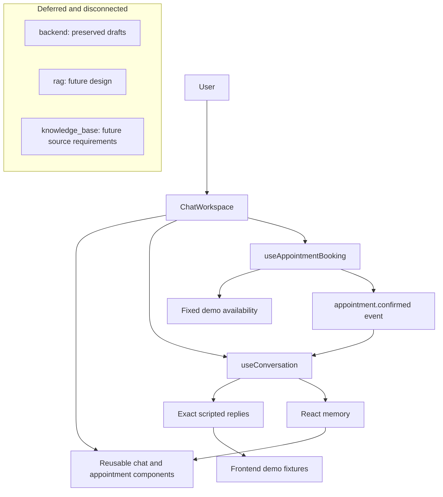
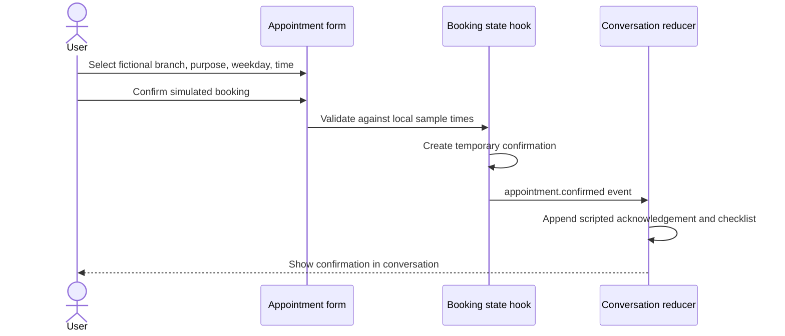

# Architecture

## Current milestone: standalone frontend

One Next.js application provides the UI. It does not call a banking API, a Python process, or an LLM. The production page can be rendered by Next.js; interactive behaviour runs in the browser.

Development and production builds explicitly use Next.js's Webpack option. Turbopack's local build-worker socket was blocked in the implementation environment; Webpack builds successfully without that worker socket. This does not change application behaviour.

### Responsibility boundaries

| Area | Responsibility |
| --- | --- |
| `src/app/` | App Router entrypoints, metadata, global styles, error boundary. |
| `src/components/layout/` | Header, explanation dialog, prototype notice. |
| `src/components/chat/` | Conversation, composer, examples, guidance cards, overview. |
| `src/components/appointments/` | Accessible form, mobile sheet, desktop panel, receipt. |
| `src/components/ui/` | Small shadcn-style components, using Radix Dialog and Tailwind. |
| `src/hooks/` | Temporary UI state and interaction coordination. |
| `src/lib/demo/` | Explicit scripted examples and presentation-only availability. |
| `src/lib/conversationReducer.ts` | Message, loading, error, panel, and booking event transitions. |
| `src/types/demo.ts` | Frontend-only types, independent of preserved Python schemas. |

## Chat flow

1. A task button supplies a scripted question, or the user types text.
2. The hook appends a user message and shows a loading indicator.
3. The mock function selects an exact script. This is not intent detection or retrieval.
4. The response includes canned text, an optional guidance card, and an optional instruction to open the booking panel.
5. The reducer updates temporary state. Unknown input receives an explicit unsupported response.

Follow-up buttons use the selected scenario. They do not infer meaning from arbitrary user text. Reset invalidates pending replies so an old reply cannot enter a new conversation.

## Booking flow

The structured event is a frontend object. It does not reach a backend or reserve a real slot. A duplicate confirmation is blocked. Closing the panel preserves unfinished form selections; refreshing clears all state. Dates are displayed in Toronto time. Mock availability uses weekdays starting tomorrow through 14 days from today, so the UI cannot offer an already elapsed time today.

The mobile panel uses Radix Dialog for keyboard focus and focus trapping. On close, focus returns to the message composer. The desktop panel is an adjacent region.

## Deliberate limits

- No authentication, real customer information, account access, or payments.
- No FastAPI server, API client, retrieval, intent classifier, embeddings, LLM, or vector database.
- No cookies, localStorage, sessionStorage, server sessions, database, or persistent reservations.
- No actual policy claims: each fixture is explicitly marked mock.
- No rescheduling or cancellation workflow. Reset starts a new demonstration.

## Future integration boundary

If approved later, `backend/` will own HTTP routes and business services, `rag/` will own intent/retrieval/generation adapters, and `knowledge_base/` will own reviewed source data. The active frontend mock functions can then be replaced by a typed API client. That work requires new approval.

Some draft RAG files currently remain under `backend/app/services/rag/`, as created before the scope change. They are inactive. Moving them to the future top-level ownership structure is deferred because the user requested preservation of existing changes.
